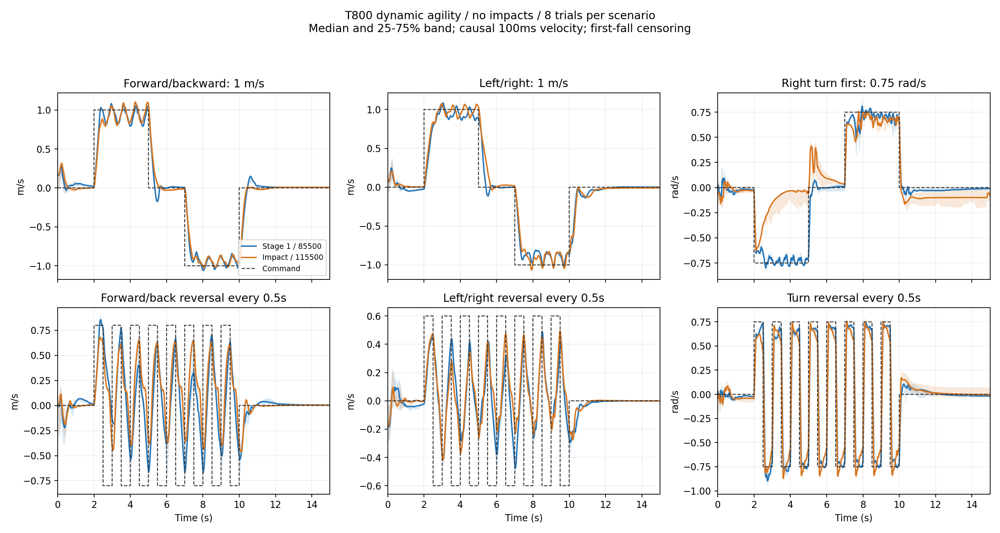

# T800 抱架行走策略动态灵活性评测（2026-11-04）

当前二阶段策略在这组测试中能稳定走动，但不能据此认为已具备足够的格斗敏捷性。最明确的问题是 **0.75 rad/s 的持续右转跟踪明显退化**；前进、右侧移达到目标速度的时间也变长。开始响应并不普遍迟缓：1 m/s 前后行走达到目标一半速度仍约需 0.2 秒。需要把起动、加速到位、保持转速和快速反向分别看。

## 测试与证据

- 已完成 Isaac Sim 无界面真实物理滚动，Slurm **13685 COMPLETED，退出码 0，7 分 44 秒**；不是读取训练奖励推测表现。
- 一阶段：`logs/cusrl/T800_base/2026-10-28-15-23-25:T800_base_2gpu_seed42/ckpt/ckpt_85500.pt`。
- 二阶段：`logs/cusrl/T800_base-Impact/2026-11-04-20-26-01:T800_base-Impact_singlehit_groundfix_from115500_to125500/ckpt/ckpt_115500.pt`。固定评测开始时选择的检查点，不随后台训练更新。
- 2 个策略 × 无击打/常见击打 × seed 42/43 × 64 环境，共 **512 段、每段最多 15 秒**。16 类场景，每个策略/工况/场景 8 段。
- 场景包括 ±0.6/1.0/1.4 m/s 前后与左右行走，±0.75/1.25/1.8 rad/s 转向且交换左右进入顺序，0.5 秒周期的前后/左右/转向切换，以及 2 秒一换的平移与转向组合。
- 平地、保留摩擦/本体随机化；健康完整头部，关闭头部故障。85500 保留原生头部观测/动作，115500 使用其二阶段头部隔离逻辑。
- 命令在 actor 推理之前更新，保留连续 LSTM 历史。使用实际执行指令和 20 ms 物理状态，不用遥控计划时间代替执行时间。
- 倒地在自动重置前捕获原始状态；首次倒地之后全部剔除。没有把倒地重置算作恢复。

完整数据为本目录的 8 组 `*_seed*.json` 与同名 `.npz`，汇总见 [summary.json](summary.json)、[summary.txt](summary.txt)。使用 `python docs/validation/agility_2026-11-04/summarize.py` 可复算汇总与图。

## 无击打：稳定性保持，动态表现存在局部退化

两策略均为 **0/128 段倒地**。时间加权平移 RMSE 为 0.250 → 0.247 m/s，整体接近；角速度 RMSE 为 0.116 → 0.161 rad/s。汇总平均值会掩盖具体方向和瞬态差异。

下表为从站稳到指定方向的命令，维持 3 秒；时间是实际速度达到新目标幅值的 90%、并连续保持至少 100 ms 的首次达标时刻，中位数。每个平移方向 8 段，全部达标。

| 命令 | 一阶段 85500 | 二阶段 115500 | 观察 |
|---|---:|---:|---|
| 前进 1 m/s | 0.32 s | 0.76 s | 加速到位变慢 |
| 后退 1 m/s | 0.36 s | 0.57 s | 变慢 |
| 左移 1 m/s | 0.70 s | 0.67 s | 接近，稍快 |
| 右移 1 m/s | 0.38 s | 0.73 s | 变慢 |

前进首 0.5 秒沿指令方向的速度积分，中位数为 0.368 → 0.314 m；首 1 秒为 0.833 → 0.778 m。差异约 5 cm，不能把 90% 达标时间的倍数直接理解为实际追击位移也差同样倍数。后退、左右方向的完整速度曲线保存在 NPZ。

**低速右转是最值得优先修复的问题。** 合并“先左后右”和“先右后左”两种进入顺序，-0.75 rad/s 命令在 3 秒窗口内的 90% 达标数为 **16/16 → 2/16**。最后 0.5 秒的平均实际右转角速度，中位数为 **-0.731 → -0.055 rad/s**。二阶段常会先转一下，随后转速衰减到接近零；这对持续面向对手、细调朝向有明显影响。1.25 rad/s 测试仍能达标，因此不能泛化为完全不能右转。

## 半秒换向：能反向，但速度常来不及到位

每个场景包含 16 个 0.5 秒命令窗，合计 128 个窗口；其中 120 次是真正从运动中的正方向直接切到负方向或反之。所有无击打快速切换场景均未倒地。以下“达到”也要求保持 100 ms。

| 快速切换目标 | 一阶段达到 50% / 90% | 二阶段达到 50% / 90% |
|---|---:|---:|
| 前后 ±0.8 m/s | 66/128；8/128 | 63/128；1/128 |
| 左右 ±0.6 m/s | 34/128；0/128 | 37/128；0/128 |
| 转向 ±0.75 rad/s | 128/128；116/128 | 128/128；97/128 |

真正反向时，二阶段前后速度跨过零并保持的达标数为 102/120，中位 0.20 秒；左右为 119/120，中位 0.30 秒；转向为 120/120，中位 0.06 秒。因此不能把未达到 90% 说成“没有响应”。这是一组用于比较的快速切换挑战，不能直接等同比赛中所有闪避动作。

2 秒一换的平移与转向组合，无击打两策略均 0/8 倒地，平移 RMSE 0.281 → 0.277 m/s，转向 RMSE 0.141 → 0.162 rad/s。这个组合测试尚不能证明能跟上半秒级的混合指令。

## 急停与带击打工况

急停同时报告两个口径：`stop` 测平滑有符号速度，适合观察漂移；`stop_raw_speed` 先取原始平移速度模长、角速度绝对值，再做因果 100 ms 平均，避免往复晃动抵消。严格口径要求平移 <0.1 m/s 且角速度 <0.15 rad/s，连续保持 100 ms；距离从停止指令前位置量到确认时刻。

| 无击打急停来源 | 一阶段严格达标/时间/净位移 | 二阶段严格达标/时间/净位移 |
|---|---|---|
| 前后 1 m/s | 16/16；0.67 s；0.117 m | 16/16；0.75 s；0.180 m |
| 左右 1 m/s | 16/16；0.69 s；0.189 m | 16/16；0.62 s；0.238 m |

时间、距离分别取中位数。净位移与累计路径不同，路径也完整保留。快速切换后的停止距离受实际速度尚未到位影响，不宜据其较小距离单独判断刹车更好。

常见击打使用现有 common 力/部位/组合分布，不改变击打参数：

| 动态 common 工况 | 一阶段 85500 | 二阶段 115500 |
|---|---:|---:|
| 首次倒地段数 | 5/128 | 2/128 |
| 有效帧平移 RMSE | 0.303 m/s | 0.281 m/s |
| 有效帧角速度 RMSE | 0.229 rad/s | 0.212 rad/s |
| 平移/转向组合场景倒地 | 1/8 | 0/8 |

本组数据支持二阶段在常见击打下仍有收益，但倒地样本数少、窗口短，不能把这个比例当作实战倒地概率或显著性结论。不同策略倒地/重置后，随机流也不保证逐击配对。未测本轮 stress，也未测执行拳法/腿法时与步行策略切换的整体表现。

## 代码改进优先级

1. **先改善命令时序覆盖。** [T800CommandsCfg](../../../source/t800_lab/t800_lab/tasks/t800_base/env_cfg.py#L113) 当前 4–6 秒才重采样一次；[采样器](../../../source/t800_lab/t800_lab/tasks/t800_base/boxing_guard_velocity_command.py#L80) 主要独立抽取模式。建议增加有顺序的前进—急停—后退、左右闪移、边移边转片段，逐渐加入 0.4–1.2 秒短段，同时保留长时间稳态和站立段。不能仅把所有段统一缩短，也不应强制小扰动时迈步。这是明确的覆盖缺口；实际收益仍需续训 A/B 验证。

2. **补低速转向与混合运动。** [配置](../../../source/t800_lab/t800_lab/tasks/t800_base/env_cfg.py#L124) 纯转向幅值为 1.0–2.1 rad/s，正交平移为 0.65–1.10 m/s，混合运动仅 5%。建议补 0.2–1.0 rad/s 的左右转向/停止过渡、低速步位微调，适度提高边走边转占比。0.75 rad/s 纯转向、0.6/1.4 m/s 正交平移本来就在对应采样范围之外，报告将其作为实用边界探测。只改通用 `ranges` 不会改变这个自定义采样器，必须改实际 `*_range`/模式采样。代码已核到转向正负号各 50%，没有发现简单的左右采样偏置；右转退化的全部因果尚未锁定。

3. **保留稳定约束，再做有证据的瞬态奖励调整。** [速度跟踪](../../../source/t800_lab/t800_lab/tasks/t800_base/env_cfg.py#L280) 已有指数奖励和 [L2 误差项](../../../source/t800_lab/t800_lab/tasks/t800_base/env_cfg.py#L386)，并非没有跟踪目标。优先评估新命令分布的效果，若仍慢，再针对切换后约 0.5–1 秒调整跟踪/停止漂移目标，保留关节限位、实际超速、足滑和倒地约束。现有 [恢复门控](../../../source/t800_lab/t800_lab/tasks/t800_impact/impact_runtime.py#L435) 需要近期受击，不会因为主动换向就自动启动。

4. **AMP 是待验证因素，不能直接认定为拖慢根因。** [策略侧 AMP](../../../source/t800_lab/t800_lab/tasks/t800_base/env_cfg.py#L180) 用目标命令，[示范侧](../../../source/t800_lab/t800_lab/tasks/t800_base/env_cfg.py#L224) 用示范实际速度；突然换向的条件分布存在不匹配可能，且已有组合示范权重较少。本轮日志没有支持“所有切换都会造成 AMP 奖励骤降”，也未证实踝关节平滑项是主因。不能据此全局降低 AMP、平滑或稳定性权重。若后续需要，使用真实连续的急停/换向示范和有限消融实验验证。

实施时建议在二阶段任务配置中覆盖命令课程，保留一阶段配置作为基线，逐项 A/B。前三项优先方案可以保持现有 actor/critic 输入与动作维度，从现有网络权重继续训练；不需要为了本轮发现先增加速度观测或重建网络。本轮仅添加测评工具和本报告，**未修改训练参数、奖励、现有训练任务或提交新的训练**。

## 指标解释与验证边界

- 50%/90% 是**新目标幅值**的达标，不是阶跃变化量的传统百分比。采用因果 100 ms 速度均值，存在滤波延迟和步态波动影响；达标后继续跟踪不保证始终不再低于阈值，所以另报最终 0.5 秒增益。失败、倒地未达标、未暴露全部独立计数，不伪造零延迟。
- 快速场景的最后 0.5 秒增益覆盖整个命令窗，不能当真正稳态增益。条件成功时间必须与成功数一起读。
- AMP hook 在 inference 中仍更新自身归一化统计，且两检查点使用各自判别器；绝对 AMP 分数不能跨策略比较，也不能证明因果。actor 的观测归一化在 inference 中冻结，运动学指标不受这个 AMP 诊断限制影响。
- 本轮保持健康头部，比较的是两套完整任务策略；没有用控制消融隔离“抗击打训练”与“头部处理”等单项影响。平地测试也未复核倒地机器人柱状障碍、笼边约束和 MuJoCo/实机差异。
- 原批量作业 13684 初始化未完成，已取消；独立诊断证明可完整滚动后，改用显式 Python 的 Slurm step 启动，13685 全部八组完成。`initialization_probe*` 只是诊断，不进入统计。
- 验证：**191 项 pytest 通过**；`ruff check source/t800_lab scripts tests` 通过；新汇总脚本 Ruff 通过；Slurm `bash -n` 通过；项目已声明 pyright 范围为 0 errors / 0 warnings。真实 GPU 八组 JSON/NPZ 均已产生，绘图已查看。

Isaac 已能完成此次定量测评。MuJoCo 后续最值得交叉验证的是：持续低速右转、前后/左右半秒反向，以及急停后的位移与摆动；当前尚未进行 MuJoCo 验证。
