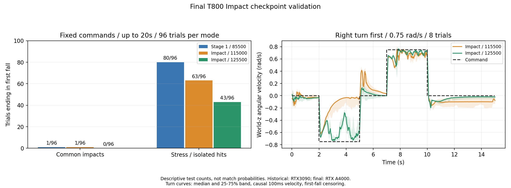

# T800 抗击打续训最终检查（2026-11-05）

抗击打续训已完成，最终检查点为 **125500**。这轮独立物理评测中，常见击打下 96 段全部完成 20 秒；压力击打倒地 43/96，历史同协议 115000 为 63/96。前后加速和低速右转较 115500 明显改善，但快速左右反向切换仍弱，不能认为格斗敏捷性已经达标。

## 训练完成情况

- 任务：`T800_base-Impact`；Slurm **13683 COMPLETED，退出码 0:0**。
- 本段运行时间：2026-11-04 20:24:25 至 2026-11-05 11:43:28，共 15:19:03。
- 以一阶段 85500 为起点，累计完成 **40000 次二阶段更新**。本段从 115500 续至 125500，最后 10000 次使用真实地面倒地判定修复和压力单击配置。
- 最终模型：[ckpt_125500.pt](../../../logs/cusrl/T800_base-Impact/2026-11-04-20-26-01:T800_base-Impact_singlehit_groundfix_from115500_to125500/ckpt/ckpt_125500.pt)。记录的任务、起始迭代、累计更新数和配置签名均一致。
- 检查点可正常读取，121 个浮点张量、5837472 个元素全部有限；训练日志 139 万个标量无 NaN/Inf，未发现训练 Traceback、显存溢出或异常退出。
- 最近 1000 次与本段较早 1000 次相比：压力失败批次均值 0.16152 → 0.13190，常见 0.09044 → 0.09351；恢复超时事件/结束回合 0.3809 → 0.2223。压力指标向好，常见大致持平。

这些训练指标有不同的分母：失败比例是重置批次均值，空类别按零计，不能当作汇总倒地率；恢复时间只统计成功恢复；速度误差日志用固定 6 秒归一化，也不能当作实际时长 RMSE。早期倒地过滤有问题，不能把修复前后的失败日志直接拼接比较。详细窗口数据见 [training_trend.json](training_trend.json)。

## 新增最终模型物理评测

评测 Slurm **13742 COMPLETED，退出码 0:0**，运行 10:21，使用 tr1 的两张 RTX A4000。测试脚本为 [evaluate.slurm](evaluate.slurm)，未修改训练参数或运行中的其他任务。

固定命令评测每工况 96 段：seed 42/43，各 48 环境、12 种站立/平移/转向命令，每段最多 20 秒。平地，保留本体和摩擦随机化；保留健康完整的物理头部，关闭故障随机化。首次倒地即停止该段指标统计，包含终止前物理帧，不把自动重置算成恢复。

| 最终 125500 工况 | 倒地段数 | 平均坚持时间，上限 20 s | 平移 RMSE | 角速度 RMSE |
|---|---:|---:|---:|---:|
| 无击打 | 0/96 | 20.00 s | 0.132 m/s | 0.140 rad/s |
| common，常见击打 | 0/96 | 20.00 s | 0.179 m/s | 0.183 rad/s |
| stress，压力击打 | 43/96 | 15.34 s | 0.481 m/s | 0.541 rad/s |

- common：710 次击打；记录 186 次成功恢复，完成恢复的平均时间 **0.443 s**，10 次恢复窗口超时。组合击打会刷新/打断观测窗口，这些数量不能相除解释为逐拳恢复率。
- stress：420 次击打；317 次成功恢复，完成恢复的平均时间 **0.660 s**，41 次恢复窗口超时。倒地和超时分开记录。
- stress 每个事件仅一击，事件间隔 2–5 秒；20 秒内可以有多次事件。它不是整段只挨一拳，也不是组合拳。采样压力峰值范围为 1600–5000 N，仍按部位冲量限幅；本轮实际采样覆盖了接近 5000 N 的击打。
- command-relative 2 秒额外位移的样本最大值：common **1.16 m**，stress **4.08 m**。这是极值，不是常见恢复距离，也不能由平均恢复时间推出位移都很小。

| 历史同协议参考 | 一阶段 85500 | 二阶段 115000 | 最终 125500 |
|---|---:|---:|---:|
| common 倒地段数 | 1/96 | 1/96 | 0/96 |
| stress 倒地段数 | 80/96 | 63/96 | 43/96 |
| stress 平均坚持时间 | 10.01 s | 12.67 s | 15.34 s |

历史固定命令评测是 **115000**，下文动态评测的旧模型是 **115500**，不能混写。历史测试使用 RTX3090，本轮使用 RTX A4000，因此这里是历史同协议参考，不是相同硬件的因果对照；不能把所有差异归因于最后 10000 次更新。平地短段测试也不是 5 分钟实战胜率。

## 走路与敏捷性

新增无击打动态评测：16 类场景 × seed 42/43，各场景合计 8 段，共 **128 段、每段 15 秒，0/128 倒地**。包括加速、停步、左右转进入顺序互换、每 0.5 秒反向和组合追击/躲避命令。保留连续 LSTM 状态，命令先于策略推理更新。

1 m/s 平移从站稳起动，达到目标速度 90% 且连续保持至少 100 ms 的首次达标时间，中位数如下；每方向 8 段，均达标：

| 方向 | 历史 115500 | 最终 125500 |
|---|---:|---:|
| 前进 | 0.76 s | **0.34 s** |
| 后退 | 0.57 s | **0.38 s** |
| 左移 | 0.67 s | **0.84 s** |
| 右移 | 0.73 s | 0.72 s |

低速右转目标为 -0.75 rad/s，合并两种进入顺序：达到过 90% 目标速度并保持 100 ms 的窗口由 **2/16 → 16/16**；命令末 0.5 秒平均实际转速的跨段中位数由 **-0.055 → -0.693 rad/s**。持续跟踪明显恢复，但曲线仍有波动，不能把“曾达标”理解为全程稳定在目标值。

快速反向仍有短板，尤其横向：每 0.5 秒切换一次方向，要求 100 ms 持续达标。

| 快速切换场景 | 历史 115500：达到 50% / 90% | 最终 125500：达到 50% / 90% |
|---|---:|---:|
| 前后，每项 128 个窗口 | 63/128；1/128 | 59/128；3/128 |
| 左右，每项 128 个窗口 | 37/128；0/128 | **10/128；0/128** |
| 转向，每项 128 个窗口 | 128/128；97/128 | 128/128；114/128 |

因此当前不能说走路能力整体退化，也不能说敏捷性已经恢复到位：前后起动和低速右转改善，左移加速及快速横向反向较弱。本轮没有重测 common 下的动态敏捷性，结论限于无击打动态场景。头部损坏、围笼边界、软垫变形、长时间实战及与主动攻击策略切换也未在这轮覆盖。

## 可复算证据

- [summary.json](summary.json)：固定命令与动态场景汇总；[summarize.py](summarize.py) 可从原始 JSON/NPZ 复算并画图。
- 本目录 8 组 `*_seed*.json`、两份动态 `.npz` 及各自输出日志为原始评测证据。
- [verification.json](verification.json)：逐段统计一致性、配置签名、模型迭代、有限值与退出状态检查；[checkpoint_integrity.json](checkpoint_integrity.json) 为模型完整性检查。
- 训练日志：[13683.out](../../../logs/slurm/T800_base-Impact-13683.out)；原始训练目录保留了 TensorBoard 事件。

本轮新增内容仅为验证脚本、数据与报告；未调整训练奖励、课程、网络或部署代码。
